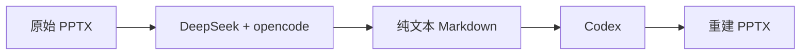

# doc2doc

用一个紧凑的纯文本 Markdown，在两台电脑之间重建 PowerPoint。



Markdown 保存文字、版面参数、图表数据和图片生成 prompt，不嵌入 base64、图片二进制、像素数组或矢量描摹。照片由接收端 agent 的原生生图能力重新生成；没有原生生图工具时，可按描述绘制 SVG 插画。无需外部生图 API 或密钥。

## 两台电脑分别怎么用

1. **A 机：PPT → Markdown。** 把 [A 手册](deliver/A_ppt2md_DeepSeek-opencode.md) 交给 DeepSeek + opencode，发送手册开头的召唤语，并提供 PPTX 路径。
2. **传输：** 只把 A 机生成的演示文稿 `.md` 交给 B 机。
3. **B 机：Markdown → PPT。** 把 [B 手册](deliver/B_md2ppt_Codex.md) 交给 Codex，发送手册开头的召唤语，并提供收到的 Markdown 路径。

两份手册各自包含环境配置、完整 Python 代码、共享格式契约和验证步骤，单独复制其中一份即可指导对应电脑完成工作。

## 本地运行

建议使用 Python 3.12。安装依赖：

```sh
python -m venv .venv
# 激活虚拟环境后执行：
python -m pip install -r requirements.txt
```

提取 PPTX 的结构和图片供 agent 分析：

```sh
python ppt2md.py dump source.pptx work
python ppt2md.py facts work
```

agent 检查图片，在 `assets.yaml` 中为每个资源编写 prompt 或可重画的数据；然后生成传输用 Markdown：

```sh
python ppt2md.py check source.pptx assets.yaml
python ppt2md.py to-md source.pptx assets.yaml deck.md
```

接收端导出图片任务，由 agent 生成对应的 `images/<id>.png` 或 `.svg`，再构建 PPTX：

```sh
python md2ppt.py prompts deck.md
python md2ppt.py check deck.md --images images
python md2ppt.py build deck.md rebuilt.pptx --images images
```

`build` 默认严格检查缺图；`--draft` 仅供调试版面，不能作为交付物。LibreOffice 用于可选的逐页预览，OCR（Optical Character Recognition，光学字符识别）依赖可选安装，详见手册。

## 文件说明

| 文件 | 用途 |
|---|---|
| `ppt2md.py` | 提取文字、样式、母版、表格、图表和图片清单 |
| `md2ppt.py` | 根据 Markdown、图表数据和生成图片重建 PPTX |
| `digitize.py` / `specs.py` | 曲线数字化与图表重画 |
| `deliver/` | 可直接交给两台电脑的自包含手册 |
| `docs_src/` | 手册模板、共享格式规范和构建脚本 |

修改工具或模板后运行 `python docs_src/build_docs.py`，同步手册中内嵌的代码。

## 保真范围

文字和版面参数按 Markdown 中的记录重建；原生表格、部分原生图表可以保留编辑能力。图片生成依赖 agent 执行，脚本本身不会自动生图。AI 重新生成的照片和插画只能近似原稿，不能还原原始像素；从截图提取的曲线属于估计数据，应核对关键数值。复杂 SmartArt、动画、视频、特殊字体和效果可能需要人工处理。

目前实现聚焦 `.pptx`，不包含通用 Word 转换。源码已做语法检查，既有流程用科研汇报和合成演示文稿验证过；跨机器安装、实际生图能力及 Office 渲染效果需在目标环境确认。

本仓库仅发布通用工具与说明，不包含原始演示文稿、工作资料、生成图片或本机配置。
